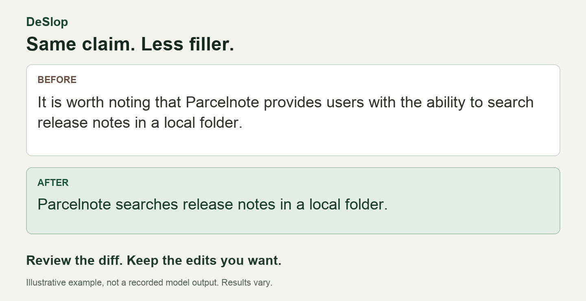

  

<h1 align="center">DeSlop: AI Slop Remover for VS Code</h1>

  <a href="https://marketplace.visualstudio.com/items?itemName=AUAggy.deslop">VS Code Marketplace</a> ·
  <a href="https://open-vsx.org/extension/AUAggy/deslop">Open VSX / VSCodium</a> ·
  <a href="https://github.com/AUAggy/deslop/releases">Download VSIX</a>

Remove AI filler from Markdown, READMEs, comments, commit messages and articles without leaving your editor. DeSlop rewrites your selection, shows a native diff, and lets you apply only the changes you choose.

Use your own **OpenRouter or Venice API key** and choose your model. No DeSlop account. Provider usage is billed to you.

Over **4,000 downloads** across the VS Code Marketplace and Open VSX.

  <a href="#getting-started">Get started</a> ·
  <a href="#review-and-choose-your-edits">Review controls</a> ·
  <a href="#settings">Settings</a> ·
  <a href="#privacy-and-costs">Privacy</a>

## Cut the filler, keep the point

DeSlop targets padded lead-ins, repeated claims, hype and canned phrasing. It edits existing prose rather than supplying missing evidence or facts.

**Before**

> It is worth noting that Parcelnote provides users with the ability to search release notes in a local folder.

**After**

> Parcelnote searches release notes in a local folder.

Illustrative edit, not a recorded model output. Results depend on your model and source text.

Technical terms such as “robust estimator” and “critical section” are not filler. Useful qualifications, constraints and deliberate voice belong in the result. Already-clear text may need no changes.

## Getting started

Install **DeSlop** from the [VS Code Marketplace](https://marketplace.visualstudio.com/items?itemName=AUAggy.deslop) or [Open VSX for VSCodium](https://open-vsx.org/extension/AUAggy/deslop). For manual installation, download a release VSIX and run **Extensions: Install from VSIX…**.

1. **Select prose**, then press **Shift+Alt+D** or run **DeSlop: DeSlop Selection**.
2. Paste your provider's API key when prompted. **Get Key** opens [OpenRouter](https://openrouter.ai/keys) or [Venice](https://venice.ai/settings/api) so you can create one, then return to setup without reselecting text.
3. Choose a document type if asked: **README**, **Docstring/Comment**, **Commit Message** or **Blog/Article**. Recognised README, comment and commit-message contexts can skip the picker; explicit defaults take precedence.
4. Review the diff. Apply the full rewrite, choose change groups, or discard it. One **Undo** restores the original selection after application.

A provider account, suitable model access, internet connection and any required credits are needed. API keys are the only connection method.

## Review and choose your edits

- **Select Change Groups** includes or excludes edits and updates the read-only preview. You can reveal a group's location from the picker. Changing the selection makes no new model request.
- **Show Current Changes** opens the model's explanations before you decide. Explanations may be incomplete; inspect the text itself.
- **Apply Selected Changes** applies the displayed result. **Accept Full Rewrite** takes every group; **Discard Rewrite** leaves the source untouched.

Related edits may stay grouped to avoid splitting markup or protected content. Ambiguous blocks can form a larger group. Check the combined result: partial acceptance is not a guarantee that meaning survives.

| Action | Windows / Linux | macOS |
|---|---|---|
| Rewrite selection | `Shift+Alt+D` | `Shift+Alt+D` |
| Select change groups | `Ctrl+Alt+G` | `Cmd+Alt+G` |
| Apply selected changes | `Ctrl+Alt+Enter` | `Cmd+Alt+Enter` |
| Discard review | `Escape` | `Escape` |

Review shortcuts apply only while the associated review is active and the picker is closed. All actions are also in the Command Palette.

## Your key, model and writing preferences

**DeSlop: Manage Connection** lets you enter or replace a key, test authentication, open your provider account or disconnect. Each provider keeps its own credential. Cancelling or failing validation during replacement leaves the stored key intact; Disconnect removes it locally after confirmation, without revoking it at the provider.

**DeSlop: Configure Editorial Preferences** offers two optional requests: preserve punctuation style and preserve paragraph/list structure. Both default off. They guide the model, not guarantee exact formatting. Changing preferences for a completed proposal requires explicit regeneration and another potentially billable request. DeSlop does not build a voice profile from your writing.

Cancel inference when needed. Retry keeps your request choices. If the source changes or closes, DeSlop blocks stale application and offers **Copy Completed Result** so the rewrite is not lost. Pending results are lost on editor reload.

## Settings

Open Settings and search for `deslop`.

| Setting | Default | Purpose |
|---|---|---|
| `deslop.provider` | `openrouter` | OpenRouter or Venice. |
| `deslop.model` | Provider-specific | Unset: `openai/gpt-6-luna` on OpenRouter; `openai-gpt-6-luna` on Venice. Explicit overrides win. |
| `deslop.defaultDocumentType` | `null` | Set a type; otherwise infer from context or ask. |
| `deslop.rememberDocumentType` | `false` | Reuse the last picked type when no default or recognised context applies. |
| `deslop.preservePunctuationStyle` | `false` | Ask the model to retain punctuation style. |
| `deslop.preserveParagraphListStructure` | `false` | Ask it to retain paragraph and list organisation. |
| `deslop.showChangeLog` | `false` | Open explanations after application. Explicit existing user choices are respected. |
| `deslop.autoAccept` | `false` | Skip review and apply the full rewrite. Keep off for partial acceptance. |

Review bypass, automatic explanations, editorial preferences and remembered type use user-level choices; workspace overrides cannot enable them. Without automatic reuse, the last document-type choice only reorders the picker.

## Privacy and costs

Selected text, editing instructions and enabled preferences go over HTTPS directly to your selected provider. There is no DeSlop inference server. Provider and upstream model-service policies apply; do not send text you would not share with them.

API keys use your editor's **SecretStorage**, not `settings.json`. DeSlop adds no telemetry and keeps pending reviews in memory rather than maintaining a writing history. Editor storage and clipboard behaviour are separate.

You pay your provider for inference. Authentication checks do not request a completion; optional model-readiness tests do, with a charge warning first. Cancelling a request cannot guarantee the provider has not already incurred usage.

## Limits

- Prose selections only, up to **16,000 characters** (roughly 3,000 words). One active operation per extension host.
- Protected-content checks cover recognised code fences, inline code and YAML/TOML frontmatter. They do not verify facts or prove meaning preservation. Check numbers, identifiers, conditions and negation before applying.
- DeSlop edits for readers. It makes no AI-detector-evasion or “undetectable text” promise.

For detailed grouping limits, editor compatibility and development checks, see [Testing](TESTING.md). The [editorial evaluation guide](evaluation/README.md) explains the corpus and review criteria; it is not a published quality benchmark.

## License

[MIT](LICENSE). [Report a bug or request a feature](https://github.com/AUAggy/deslop/issues).
